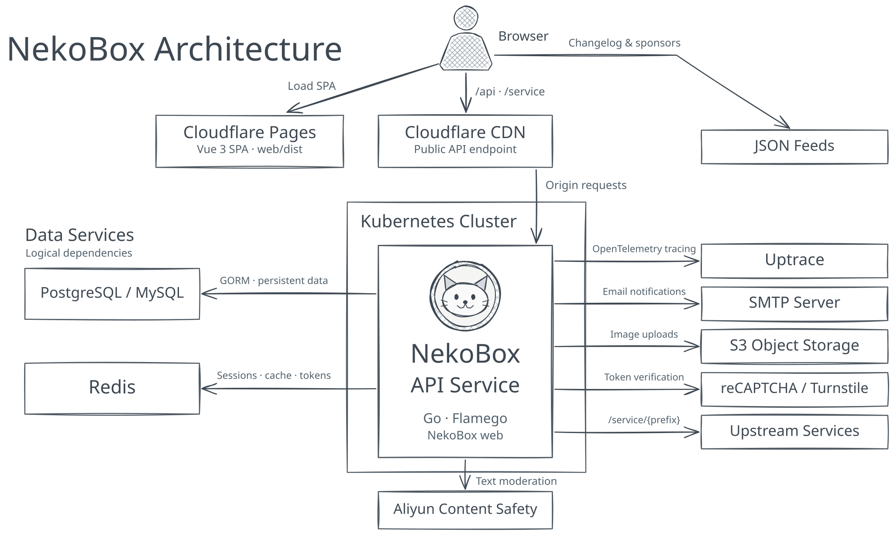

<h1 align="center">


NekoBox
</h1>

<p align="center">
匿名提问箱 / Anonymous Question Box
</p>

<div align="center">

[](https://github.com/wuhan005/NekoBox/actions/workflows/go.yml)
[](https://github.com/wuhan005/NekoBox/actions/workflows/docker.yml)
[](https://codecov.io/gh/wuhan005/NekoBox)
[](https://pkg.go.dev/github.com/wuhan005/NekoBox)
[](https://deepsource.io/gh/wuhan005/NekoBox/?ref=repository-badge)

</div>

<p align="center">
<a href="/README.zh-CN.md">简体中文</a> | <a href="/README.md">English</a>
</p>

## Architecture

<picture>
  <source media="(prefers-color-scheme: dark)" srcset="./dev/architecture-dark.svg">
  
</picture>

## Deployment

### Deploy with an Agent

Copy this prompt into an Agent with terminal access to your deployment host.

```text
Read the deployment guide at https://github.com/wuhan005/NekoBox/blob/master/README.md
and deploy NekoBox on the target server. Build and start the Go API, then build and serve the Vue frontend separately.
Ask me for any missing deployment settings.
Verify that the frontend loads and GET /api/config returns HTTP 200 with JSON,
then report the site URL.
```

### Build from Source

| Component    | Build directory | Toolchain                 | Output      |
|--------------|-----------------|---------------------------|-------------|
| Go API       | Repository root | Go 1.27+                  | `NekoBox`   |
| Vue frontend | `web/`          | Node.js 22.12+ and pnpm 9 | `web/dist/` |

#### Backend

```bash
git clone https://github.com/wuhan005/NekoBox.git
cd NekoBox
go build -o NekoBox ./cmd
cp conf/app.sample.ini conf/app.ini
```

For Linux AMD64, prefix the build command with `GOOS=linux GOARCH=amd64`.

Edit `conf/app.ini` before starting the API. See the [configuration template](./conf/app.sample.ini) for other settings.

- `[app] external_url` is the public frontend URL.
- `[app] icp` optionally sets the ICP registration number displayed in the footer.
- `[captcha] type` selects `recaptcha` or `go_captcha`. For reCAPTCHA, set `[recaptcha] site_key` and its matching
  `server_key`. Set `domain` to the script origin if you need to override the default `https://recaptcha.net`.
- Set `[server] port` to `8080` for the Docker example below.
- Set `type` (`postgres` or `mysql`), `host`, `port`, `user`, `password`, and `name` under `[database]`. Set `addr`
  under `[redis]`.

```bash
./NekoBox web
```

#### Frontend

Create `web/.env.production.local` to point the frontend at your API.

```dotenv
VITE_BASE_URL=/api
```

The frontend reads the site URL, ICP number, and public captcha settings at runtime from `GET /api/config`.
This replaces `GET /api/captcha/config`. When upgrading, move any values set only in `VITE_EXTERNAL_URL`,
`VITE_ICP`, or `VITE_RECAPTCHA_SITE_KEY` into the backend settings above before deploying the new frontend.

```bash
cd web
pnpm install --frozen-lockfile
pnpm build
```

### Frontend Hosting

Serve `web/dist/` with an `index.html` fallback for frontend routes.

- **Same origin.** Use `VITE_BASE_URL=/api` and proxy `/api/` and `/service/` to the backend with their paths intact.
- **Separate origins.** Set `VITE_BASE_URL` to the full API URL (e.g. `https://api.example.com/api`) and add the
  frontend host (e.g. `box.example.com`) to `[app] cors_allow_domains`.

### Docker Deployment

Images are published for each Git tag.

- API — `ghcr.io/wuhan005/nekobox:<tag>`
- Frontend — `ghcr.io/wuhan005/nekobox-web:<tag>` (built with `web/.env.production`)

#### Self-Hosting

Build the backend image from the root of a fresh checkout.

```bash
docker build -t nekobox-api .
```

Prepare `conf/app.ini` and `web/.env.production.local` as above. Use database and Redis addresses reachable from the
backend container. Then run from the repository root.

```bash
docker build -t nekobox-web ./web

docker run -d --name nekobox-api -p 127.0.0.1:8080:8080 \
  -v "$PWD/conf/app.ini:/home/app/conf/app.ini:ro" nekobox-api
docker run -d --name nekobox-web -p 127.0.0.1:8081:80 nekobox-web
```

For same-origin hosting, route `/api/` and `/service/` to `127.0.0.1:8080` and frontend traffic to `127.0.0.1:8081`.

## License

[MIT License](./LICENSE)
