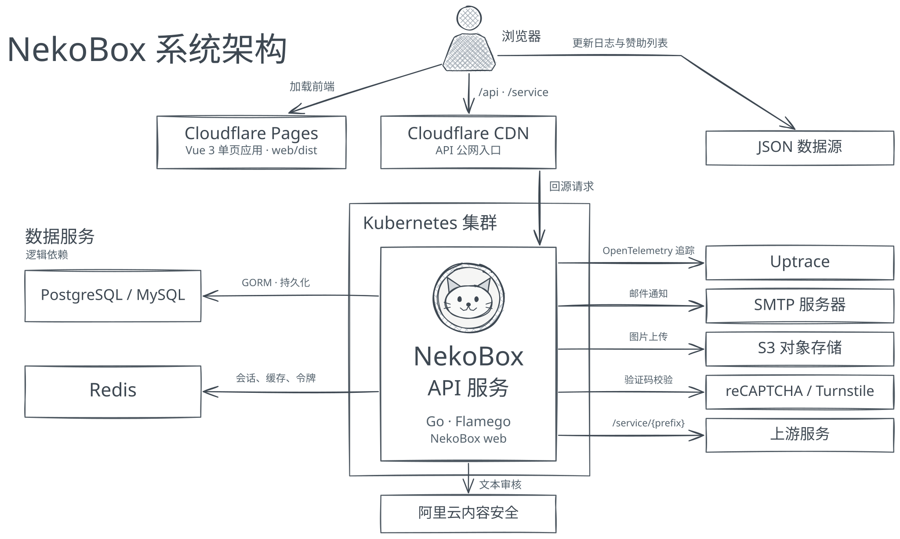

<h1 align="center">


NekoBox
</h1>

<p align="center">
匿名提问箱 / Anonymous Question Box
</p>

<div align="center">

[](https://github.com/wuhan005/NekoBox/actions/workflows/go.yml)
[](https://github.com/wuhan005/NekoBox/actions/workflows/docker.yml)
[](https://codecov.io/gh/wuhan005/NekoBox)
[](https://pkg.go.dev/github.com/wuhan005/NekoBox)
[](https://deepsource.io/gh/wuhan005/NekoBox/?ref=repository-badge)

</div>

<p align="center">
<a href="/README.zh-CN.md">简体中文</a> | <a href="/README.md">English</a>
</p>

## 系统架构

<picture>
  <source media="(prefers-color-scheme: dark)" srcset="./dev/architecture-zh-CN-dark.svg">
  
</picture>

## 部署

### 让 Agent 部署

把下面的提示词复制给你的 Agent。

```text
阅读 https://github.com/wuhan005/NekoBox/blob/master/README.zh-CN.md 的部署说明，
在目标服务器上部署 NekoBox，编译并启动 Go API，单独构建并托管 Vue 前端。
缺少部署配置时向我确认。
验证前端页面能打开，且 GET /api/captcha/config 返回 HTTP 200 和 JSON，再告诉我站点地址。
```

### 从源码构建

| 组件     | 构建目录   | 工具链                     | 产物          |
|--------|--------|-------------------------|-------------|
| Go API | 仓库根目录  | Go 1.27+                | `NekoBox`   |
| Vue 前端 | `web/` | Node.js 22.12+ 和 pnpm 9 | `web/dist/` |

#### 后端

```bash
git clone https://github.com/wuhan005/NekoBox.git
cd NekoBox
go build -o NekoBox ./cmd
cp conf/app.sample.ini conf/app.ini
```

交叉编译 Linux AMD64 时，在构建命令前加上环境变量： `GOOS=linux GOARCH=amd64`。

启动前编辑 `conf/app.ini`。其他选项见[配置模板](./conf/app.sample.ini)。

- `[app] external_url` 填写前端公开访问地址。
- `[server] port` 填写下方 Docker 示例使用的 `8080`。
- 在 `[database]` 中填写 `type`（`postgres` 或 `mysql`）、`host`、`port`、`user`、`password` 和 `name`。
  在 `[redis]` 中填写 `addr`。

```bash
./NekoBox web
```

#### 前端

创建 `web/.env.production.local`，填写站点地址和 API 路径。

```dotenv
VITE_EXTERNAL_URL=https://box.example.com
VITE_BASE_URL=/api
```

使用 reCAPTCHA 验证码时，需要设置 `VITE_RECAPTCHA_SITE_KEY` 环境变量，并在后端的 `[recaptcha] server_key` 填写配对的密钥。

```bash
cd web
pnpm install --frozen-lockfile
pnpm build
```

### 前端托管

托管 `web/dist/`，并为前端页面路由配置 `index.html` 回退。

- **同源部署**。使用 `VITE_BASE_URL=/api`，将 `/api/` 和 `/service/` 按原路径转发给后端。
- **跨域部署**。将 `VITE_BASE_URL` 设为完整的 API 地址（如 `https://api.example.com/api`），
  并在 `[app] cors_allow_domains` 中加入前端主机名（如 `box.example.com`）。

### Docker 部署

镜像按 Git 标签发布。

- API — `ghcr.io/wuhan005/nekobox:<tag>`
- 前端 — `ghcr.io/wuhan005/nekobox-web:<tag>`（使用 `web/.env.production` 构建）

#### 自托管

在新克隆的仓库根目录构建后端镜像。

```bash
docker build -t nekobox-api .
```

按上文准备 `conf/app.ini` 和 `web/.env.production.local`，确保后端容器可访问数据库和 Redis。然后在仓库根目录执行以下命令。

```bash
docker build -t nekobox-web ./web

docker run -d --name nekobox-api -p 127.0.0.1:8080:8080 \
  -v "$PWD/conf/app.ini:/home/app/conf/app.ini:ro" nekobox-api
docker run -d --name nekobox-web -p 127.0.0.1:8081:80 nekobox-web
```

同源部署时，将 `/api/` 和 `/service/` 转发到 `127.0.0.1:8080`，将前端请求转发到 `127.0.0.1:8081`。

## 开源协议

[MIT 许可证](./LICENSE)
